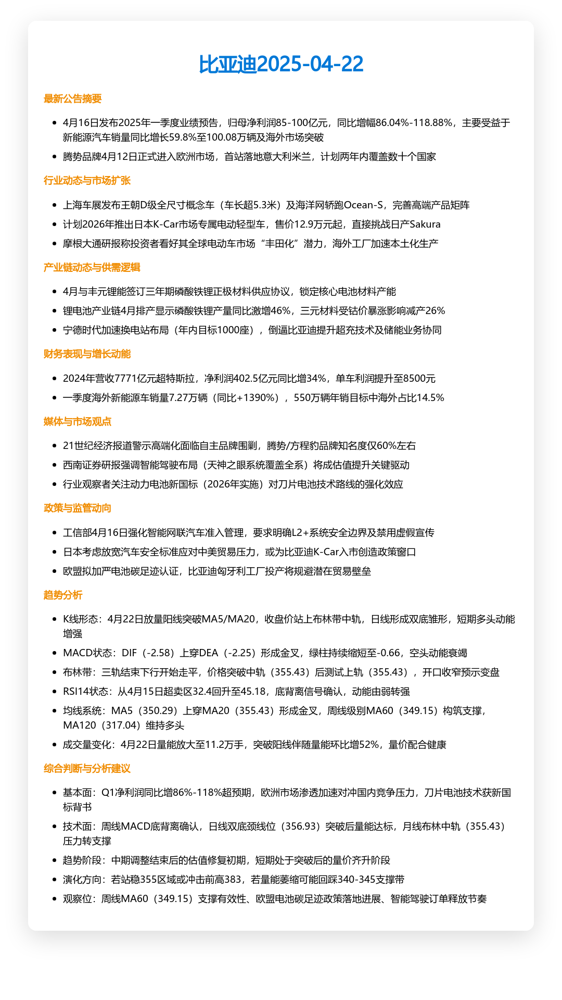
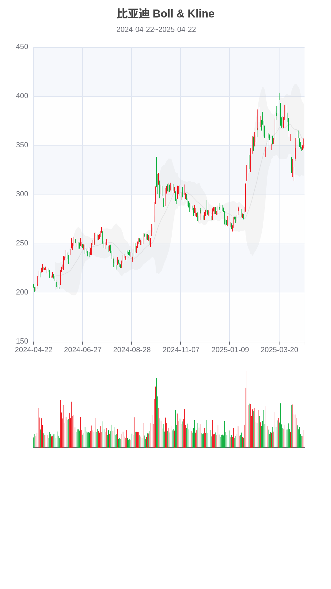

# Stock-Insight-AI 🎥  
**一键生成股票与期货深度分析视频**

Stock-Insight-AI 是一个面向金融领域的智能分析工具，专注于股票与期货数据的获取、AI 深度解析、可视化图表绘制以及高质量分析视频的自动化生成。通过本项目，您可以轻松完成从原始数据到专业级市场解读视频的全流程输出。

## 核心亮点 🔍

- **📈 实时数据采集**：自动从东方财富网等权威平台抓取股票与期货的历史行情和最新资讯。
- **🧠 AI 多维洞察**：结合腾讯元宝大模型，对技术指标（如均线、布林带、MACD 等）进行多维度解读，提供通俗易懂的市场分析报告。
- **📊 动态图表展示**：基于 `PyEcharts` 和 `Pyppeteer` 绘制动态 K 线图，并支持全局背景模式与滑动窗口模式，呈现时间序列变化趋势。
- **🗣️ 语音解说生成**：集成 Dashscope 与 Hailuo TTS 引擎，将文字报告转化为自然流畅的语音解说。
- **🎥 视频智能合成**：使用 `MoviePy` 将图表、语音与字幕融合，生成专业级分析视频，便于传播与分享。

无论您是投资者、分析师、财经博主还是量化交易者，Stock-Insight-AI 都能为您提供一站式的智能分析与内容创作解决方案！

## 示例输出 📹

- 以下为生成的分析报告与 K 线图表的静态截图示例：

<table>
    <thead>
        <tr>
            <th align="center">报告</th>
            <th align="center">K 线</th>
        </tr>
    </thead>
    <tbody>
        <tr>
            <td align="center">
                
            </td>
            <td align="center">
                
            </td>
        </tr>
    </tbody>
</table>

- 以下是一些示例视频，展示了不同分析模式的效果：

<table>
    <thead>
        <tr>
            <th align="center">全局背景模式</th>
            <th align="center">滑动窗口模式</th>
            <th align="center">期货分析示例</th>
        </tr>
    </thead>
    <tbody>
        <tr>
            <td align="center">
                <video controls width="180" height="320" src="https://github.com/user-attachments/assets/34b47522-56da-41ab-8d89-433908d66f92"></video>
                <br>比亚迪（002594）
            </td>
            <td align="center">
                <video controls width="180" height="320" src="https://github.com/user-attachments/assets/24a50c51-39ec-4e29-b7a9-298e675361d5"></video>
                <br>比亚迪（002594）
            </td>
            <td align="center">
                <video controls width="180" height="320" src="https://github.com/user-attachments/assets/abdbfea1-61b9-47f2-beb0-d716cefa805b"></video>
                <br>塑料主连
            </td>
        </tr>
    </tbody>
</table>

## 功能模块一览 🧩

### 1. 数据获取与处理  
- **路径**: `core/fetcher/base.py, futures.py, stock.py`  
- **功能**: 从权威平台获取股票或期货历史数据，并计算常用技术指标。

### 2. K线图绘制  
- **路径**: `core/kline/base.py, bg.py, windows.py`  
- **功能**: 使用 PyEcharts 绘制 K 线图并生成静态图片，支持：
  - **bg（全局背景模式）**：完整展示所有历史数据，逐步添加每日 K 线，动态呈现趋势演变。
  - **windows（滑动窗口模式）**：聚焦局部细节，通过滑动窗口逐段分析。

### 3. LLM 市场分析  
- **路径**: `core/llm/base.py, futures.py, stock.py`  
- **功能**: 利用腾讯元宝大模型对数据进行深入解读，生成通俗易懂的市场解盘文案。

### 4. 报告生成  
- **路径**: [utils/report.py](file:///home/FinVizAI/utils/report.py)  
- **功能**: 将分析结果生成图文报告图片，用于视频合成。

### 5. TTS 语音生成  
- **路径**: `core/tts/base.py, dashscope.py, hailuo.py`  
- **功能**: 支持 Dashscope 与 Hailuo 引擎，将文本报告转为语音解说。

### 6. 视频合成  
- **路径**: [utils/video.py](file:///home/FinVizAI/utils/video.py)  
- **功能**: 使用 MoviePy 合成图表、语音与字幕，生成高质量视频。

## 快速开始 ⚡

### 克隆项目  
```bash
git clone https://github.com/chenwr727/Stock-Insight-AI.git
cd Stock-Insight-AI
```

### 安装依赖  
```bash
pip install -r requirements.txt
```

### 配置参数  
```bash
cp config-example.toml config.toml
```
编辑 `config.toml` 文件，填写 API 密钥、模型名称及输出目录等信息。

### 启动服务  
```bash
python main.py
```


## 注意事项 ⚠️

- 确保配置文件中 API 密钥正确无误。
- 运行环境需安装 `ffmpeg` 等必要工具。
- 生成的视频文件默认保存在 `output` 目录下。

## 贡献指南 🤝

欢迎提交 Issues 与 Pull Requests！我们期待您的参与与反馈。

## 许可证 📜

MIT